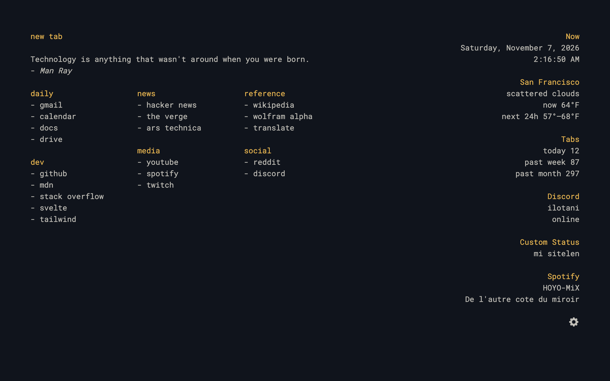
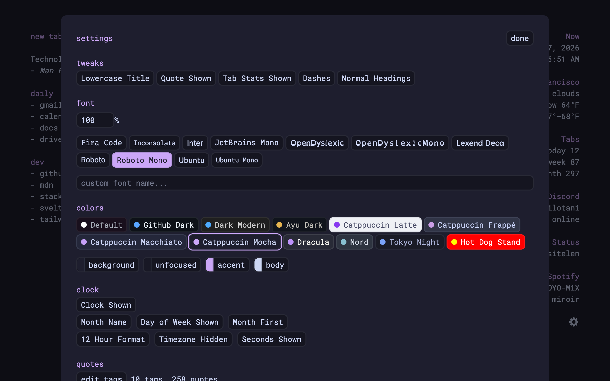
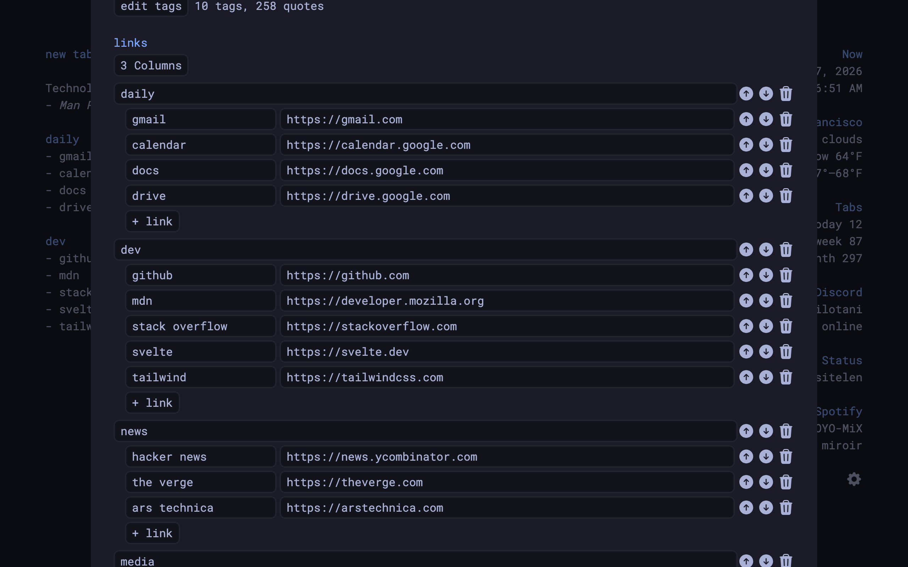
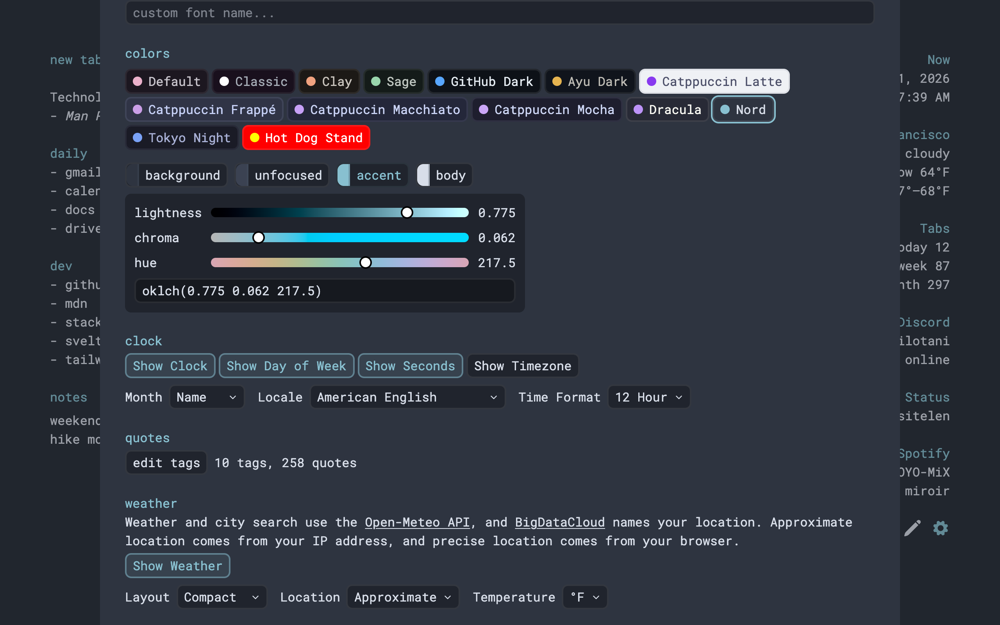
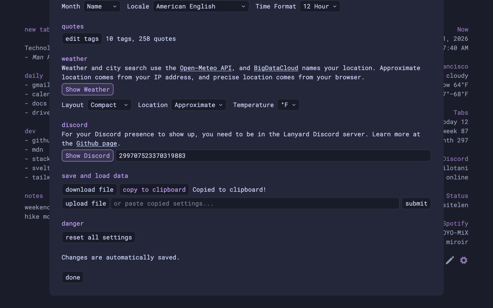

# Simple New Tab

A minimalistic, configurable new tab page. Works with Chromium-based browsers and Firefox.

- [Chrome Extension](https://chrome.google.com/webstore/detail/simple-new-tab/knjgndjhindbbphlfnaagilhcjciehaf)
- [Firefox Add-on](https://addons.mozilla.org/en-US/firefox/addon/minimalistic-new-tab/)

## Features

- Minimalistic design.
- Easy to configure.
  
- Organize your links into sections and columns.
  
- Use a preset theme or craft your own.
  
- A new quote every time you open a new tab.
- Clock with the current local time.
- Weather information in your area, powered by [OpenWeather](https://openweathermap.org/).
- Stats on how many tabs you've opened.
- Your Discord status at a glance.
- Show or hide anything you don't need.
- Import and export your settings.
  

## Build

For reviewers: releases are built on macOS 27 (arm64) with:

- [Node.js](https://nodejs.org/) 24.21.0
- [pnpm](https://pnpm.io/) 12.9.0, installed with `npm install -g pnpm@12.9.0`
- `zip` 3.0, only needed for `pnpm zip`

To build the extension:

1.  Clone the repository.
2.  Run `pnpm i --frozen-lockfile` to install dependencies.
3.  Run `pnpm build` to build the extension into `/dist`.
4.  Load the extension from `/dist` as an unpacked extension into your browser.

To package a release, run `pnpm zip` to build and zip the extension, and `pnpm zip:source` to zip the source code.

## Develop

1.  Clone the repository.
2.  Run `pnpm i` to install dependencies.
3.  Run `pnpm dev` to start a local development server.
